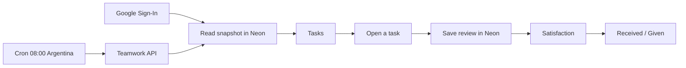
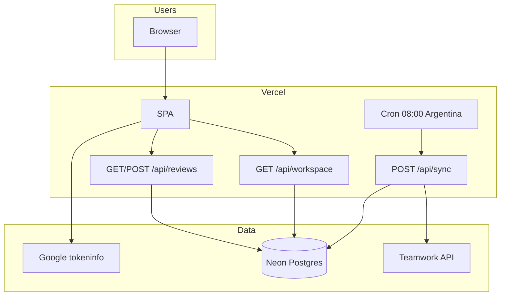
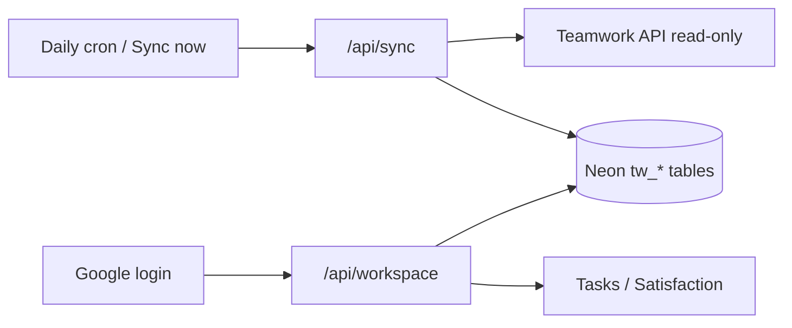
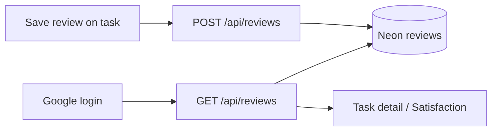

# Task Rank

Internal app for **PM ↔ Dev** ratings on real Teamwork tasks.

Ratings live in Task Rank, not in Teamwork. Teamwork is a read-only source of tasks.

**Production:** [https://task-rank.vercel.app](https://task-rank.vercel.app)

---

## What it solves

During or after a task, every assigned PM and Dev can rate each other. Each person sees how they were rated and how they rated others, by project and period.

It does not replace Teamwork. It fills the feedback loop Teamwork does not have.

---

## Flow

1. Sign in with **Google**. The email must match the person in Teamwork.
2. Login **does not call Teamwork**. The app reads a shared snapshot in Neon.
3. You see **your tasks** (projects, status, still unrated).
4. Open a task and rate the other assignees — or read the rating they left you.
5. **Satisfaction** shows received and given averages, by aspect, project, and period.
6. A daily cron (or an admin **Sync now**) refreshes the snapshot from Teamwork.

`dev@bestworlddsweb.com` is the superuser: sees every task and can impersonate. Everyone else only sees their own work.

There is a **demo** mode (sample data, no Teamwork) for walkthroughs.

---

## Features

### Access

- Google Sign-In (GIS). The ID token lasts about one hour; when it expires, sign in again.
- Scope by email: Google account = Teamwork person.
- Superuser sees everything; others only see tasks they are assigned to.
- Demo data for walkthroughs.

### Tasks

- Assigned task list with project, Devs, PMs, status, and dates.
- Filters: all projects, in progress, completed, **unrated**.
- Multiple Devs and multiple PMs per task.
- The Satisfaction column is the average of **PM → Dev** reviews on that task.
- You can rate while the task is in progress or after it is closed.

### Ratings

Each Dev–PM pair on a task opens two slots:

| Direction | Who rates | Aspects |
| --- | --- | --- |
| PM → Dev | the PM | Delivery, Follow-up, Communication |
| Dev → PM | the Dev | Scope clarity, Follow-up, Communication |

- 1–5 stars per aspect, plus an optional comment.
- One unique review per `(task, direction, rater, ratee)`. It can be edited.
- The person who was rated sees it on the task (read-only) and in Satisfaction → Received.
- No email is sent. Nothing is written back to Teamwork.

### Satisfaction

Everything is scoped to **period + project**:

- Periods: last 30 / 90 days, this month, this year.
- Filter by project.
- **Received**: average of ratings of you.
- **Given**: average of ratings you left.
- Breakdown by aspect (as Dev and as PM, when both apply).
- Project cards (received / given).
- Review list and a task table with received/given in that view.

Averages include **every pair** for that person in the current slice, not a single rater.

---

## Infrastructure

| Piece | Role |
| --- | --- |
| **Vite + React + TypeScript** | Front end |
| **Vercel** | Hosting and `/api/*` functions |
| **Neon (Postgres)** | Reviews and the Teamwork snapshot |
| **Google Identity** | Sign-in |
| **Teamwork API v3** | Read people, projects, tasks |
| **Vercel Cron** | Daily sync at 08:00 Argentina (`0 11 * * *` UTC) |

### What Neon stores

| Table | Contents |
| --- | --- |
| `tw_people` | People from Teamwork (id, name, role, email) |
| `tw_projects` | Active projects |
| `tw_tasks` | Mapped tasks (Devs, PMs, assignees, status, dates); `active` flags tasks still present in the last crawl |
| `sync_state` | Last sync time/status, running lock, counts |
| `reviews` | PM ↔ Dev ratings (stars + comment); unique on `(task_id, direction, rater_id, ratee_id)` |

---

### Teamwork → Neon (task snapshot)

Teamwork is **read-only**. We never write tasks or ratings back to it. Login never calls Teamwork; it only reads Neon.

**Who triggers it**

| Trigger | When | Who |
| --- | --- | --- |
| Vercel Cron → `POST /api/sync` | Daily at 08:00 Argentina (`0 11 * * *` UTC) | Platform |
| **Sync now** → `POST /api/sync` | On demand | Superuser only (`dev@bestworlddsweb.com`) |

**What the sync job does** (`api/sync.ts`)

1. Takes a lock in `sync_state` (blocks a second run for ~20 minutes).
2. Crawls Teamwork API v3 with the server API key:
   - people
   - active projects
   - tasks (including completed; page size 250)
   - tasklists only if needed to resolve project ids
3. Maps raw Teamwork payloads into app people / projects / tasks (roles from job titles; Devs = assignees minus PMs; PMs = PM-titled assignees + creator fallback).
4. Upserts into `tw_people`, `tw_projects`, `tw_tasks` (deduped by id).
5. Marks tasks missing from this crawl as `active = false` (rows kept if they still have reviews).
6. Updates `sync_state` (`ok` / `error`, counts, timestamps) and releases the lock.

**How the browser gets tasks**

1. After Google sign-in → `GET /api/workspace` with the Google ID token.
2. Server loads the snapshot from Neon and scopes it: superuser gets everything; everyone else only tasks where they are Dev, PM, or assignee (matched by Google email ↔ Teamwork email).
3. Front end caches that workspace in `localStorage` for the session UI; the source of truth is Neon.

---

### Ratings → Neon (`/api/reviews`)

Ratings never touch Teamwork. The only API is **`/api/reviews`** (`api/reviews.ts`). Auth is always `Authorization: Bearer <Google ID token>`.

| Method | Purpose | Response |
| --- | --- | --- |
| `GET /api/reviews` | Load ratings for the signed-in user | `{ reviews: [...] }` |
| `POST` or `PUT /api/reviews` | Create or update one or more ratings | `{ review }` or `{ reviews: [...] }` |

**GET — who sees what**

- Superuser (`dev@bestworlddsweb.com`): every row in `reviews`.
- Everyone else: rows where `saved_by_email`, `rater_email`, or `ratee_email` matches their Google email (so you see what you wrote and what you received).

**POST/PUT — save**

Body is one review object, or `{ reviews: [...] }`. Each item includes:

`id`, `taskId`, `direction` (`pm_to_dev` \| `dev_to_pm`), `raterId`, `rateeId`, `scores`, `detail`, optional `createdAt`, optional `raterEmail` / `rateeEmail`.

Server behavior:

1. Verifies the Google token.
2. Rejects self-ratings; non-superusers can only save as themselves.
3. Upserts into Neon on unique `(task_id, direction, rater_id, ratee_id)` — same slot updates scores/comment; different pairs stay separate.
4. Stores `rater_email`, `ratee_email`, and `saved_by_email` so Received works for the ratee.

**Front-end flow**

1. After login → `GET /api/reviews` to hydrate Satisfaction and task review slots.
2. Save on a task → `POST /api/reviews`.
3. A local cache can push older local-only reviews into Neon once if they are missing (one-time migrate).

---

## What it does not do (on purpose)

- Does not write comments, ratings, or changes to Teamwork.
- Does not notify via email, Slack, or Teamwork.
- Is not a timesheet or a board replacement.
- A teammate whose Google email does not match Teamwork will not see their tasks.

---

## How the team uses it

1. Open [task-rank.vercel.app](https://task-rank.vercel.app) with the company Google account.
2. In **Tasks**, open an assigned task and complete the review of the other role.
3. In **Satisfaction**, check Received / Given for the period.
4. New Teamwork tasks show up after the 08:00 sync (or when an admin runs Sync now).
